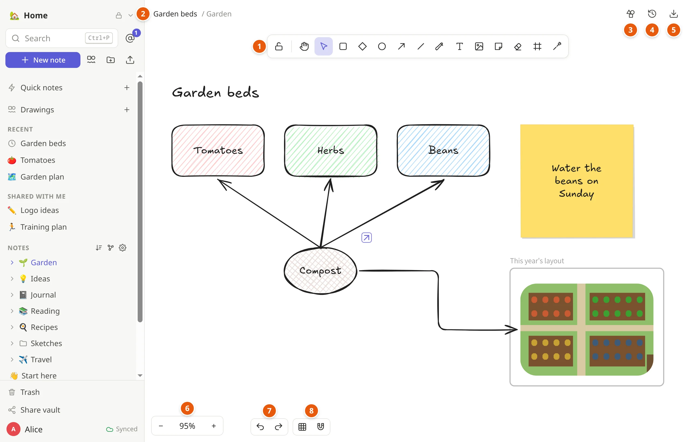
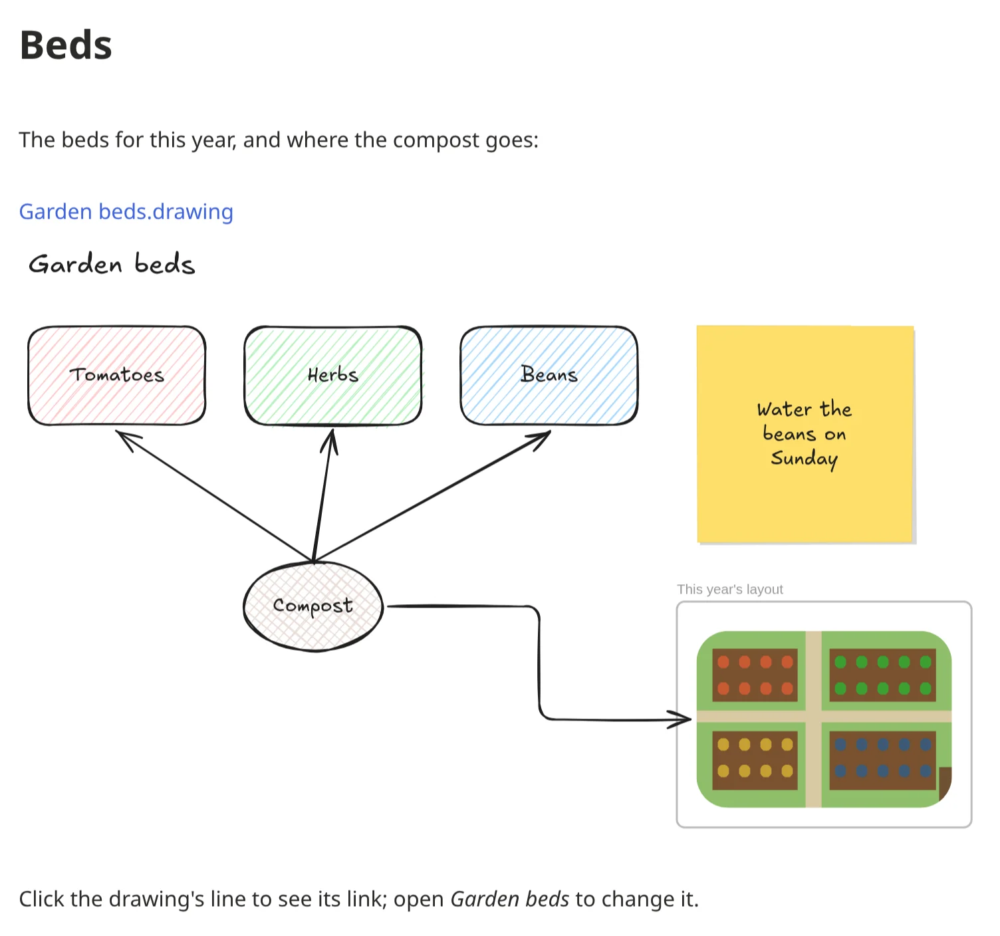
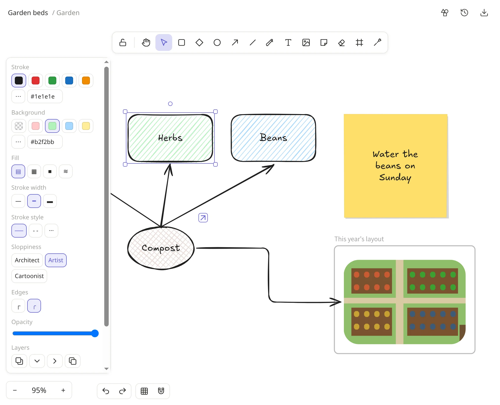

# Drawings

A drawing is a whiteboard in your vault: boxes, circles, arrows, text,
sticky notes, pictures and freehand lines, with a hand-drawn look (or a
neat one). Use it to sketch an idea, plan a room or a garden, explain
something with arrows, or write on a picture. You can draw together with
the people you share the vault with, live.

Drawings work with [Excalidraw](https://excalidraw.com): a drawing opens
there looking the same, and Excalidraw's drawings come in here.

Not to be confused with a [diagram](writing.md#diagrams): a diagram is
typed as text inside a note and laid out for you; a drawing is drawn by
hand and everything stays where you put it. [Diagram or
drawing?](writing.md#diagram-or-drawing) compares the two.

On a Mac, press `⌘` where this page says `Ctrl`.

1. **The tools**: shapes, arrows, the pen, text, pictures and more
   ([below](#the-tools)).
2. **The drawing's name**: click it to rename the drawing.
3. **Saved shapes**: shapes you keep, to use in any drawing.
4. **Version history**: earlier versions, to restore or download.
5. **Download** (⤓): as a picture or a file for Excalidraw or Obsidian,
   or copy it; also copies the line that shows it in a note.
6. **Zoom** out and in; the percentage shows how far.
7. **Undo and redo**.
8. **The grid** and **snapping** to other shapes.

## Starting one

* The drawing button next to **New note** in the sidebar starts one in the
  vault. Give it a name at the top.
* **Drawings** in the sidebar shows every drawing of the vault as a
  picture. They're also in the sidebar's folders, among the notes, and
  move and rename like notes.
* To show a drawing inside a note, write `![[Garden beds.drawing]]`
  (the ⤓ menu at the top of a drawing copies it for you). The note shows
  the drawing, kept up to date as it changes:

  

## The tools

The toolbar at the top, each with its key:

| Tool | Key | For |
|---|---|---|
| Hand | `H` | moving around the drawing (or hold `Space` and drag) |
| Selection | `V` or `1` | picking things to move, resize or change |
| Rectangle, Diamond, Ellipse | `R`, `D`, `O` (or `2`, `3`, `4`) | shapes: drag to draw one |
| Arrow | `A` or `5` | arrows, which stick to the shapes they point at |
| Line | `L` or `6` | lines; click point by point for a path |
| Draw | `P` or `7` | freehand, like a pen |
| Text | `T` or `8` | text anywhere |
| Insert image | `9` | a picture (or paste or drop one) |
| Sticky note | `N` | a sticky note, dated |
| Eraser | `E` or `0` | rubbing things out |
| Frame | `F` | a frame that holds what's in it |
| Laser pointer | `K` | pointing at things for others to see; it fades |

After drawing a shape, the tool goes back to *Selection*. `Q` (or the lock
at the start of the toolbar) keeps the tool, to draw several in a row.

## Changing what you drew

* **Select** with a click, several with `Shift`+click or by dragging a box
  around them. Drag to move, pull the handles to resize or turn.
* **The panel** beside a selection changes its colors and fill (hachure,
  cross-hatch, solid), the stroke's width and style, how sloppy the hand
  looks, round or sharp edges, the font and size of text, and opacity.

  
* **Text in a shape**: double-click the shape (or select it and press
  Enter) and type. The text wraps, and the shape grows to hold it.
  Double-click an arrow or line to give it a label.
* **Arrows** dropped near a shape attach to it, and follow it when it
  moves. Arrow types: sharp, curved, or elbow (right angles, finding
  their own way around).
* **Copy**: `Ctrl+D` duplicates, `Alt`+drag drags a copy.
* **Group** (`Ctrl+G`, `Ctrl+Shift+G` to ungroup), **lock** so it can't
  be moved by accident (`Ctrl+Shift+L`), bring forward or send backward
  (`Ctrl+]`, `Ctrl+[`), align and spread evenly.
* **Delete** with `Delete` or `Backspace`.
* **Undo** with `Ctrl+Z`, **redo** with `Ctrl+Shift+Z`: your own changes,
  not those of others drawing at the same time.

## Moving around

The mouse wheel scrolls; `Ctrl`+wheel (or pinching on a touchpad) zooms.
On a touch screen, two fingers pinch to zoom. `Shift+1` shows the whole
drawing. `Ctrl+'` shows a grid, and `Alt+S` makes things snap to the
edges and centers of others as you move them (hold `Ctrl` while dragging
to stop snapping that once).

## Pictures

Paste or drop a picture onto a drawing, or use *Insert image* (`9`).
Double-click it (or press Enter) to crop it. Pictures are kept as files of
the vault, encrypted, in an `attachments` folder next to the drawing.

## Sticky notes and frames

* **Sticky notes** (`N`): type on them; the text shrinks to fit, and the
  day you made it is written at its foot.
* **Frames** (`F`) group a part of the drawing: what you draw or drop
  inside moves with the frame and is cut off at its edge. Double-click its
  name to rename it. A frame selected on its own is what gets exported or
  copied, alone.

## Links

Select something and press `Ctrl+K` to link it to a web page, or to a note
of the vault (`[[Trip plan]]`). A button by it then opens the link.

## Saved shapes

Shapes you use again and again (a symbol, a template) can be kept: select
them, open *Saved shapes* (the button with the overlapping shapes) and
choose *Add to saved shapes*. From there, drag them into any other
drawing. They're yours, on all your devices.
Excalidraw's `.excalidrawlib` libraries can be imported there too, and
yours exported.

## Drawing together

Everyone in the vault can open the same drawing at once: you see their
pointers with their names, what they've selected and their laser pointer,
and who is on the drawing at the top. Drawn offline? It merges when you're
back. *Version history* (the clock) keeps earlier versions, shown as
pictures, to restore or download.

## Excalidraw, Obsidian, and pictures

* **Copy and paste** between notekpr and excalidraw.com (or Obsidian's
  Excalidraw plugin) both ways.
* **Download** from the ⤓ menu at the top: as a picture (PNG or SVG), as a
  file for Excalidraw (`.excalidraw`) or for Obsidian
  (`.excalidraw.md`), or as notekpr's own `.drawing`. The pictures keep the
  drawing inside, so they open again as drawings. `Shift+Alt+C` copies the
  drawing (or what's selected) as a picture.
* **Importing** a folder or an Obsidian vault turns its Excalidraw drawings
  into drawings. Dropping an Excalidraw file onto a drawing adds what's in
  it.
