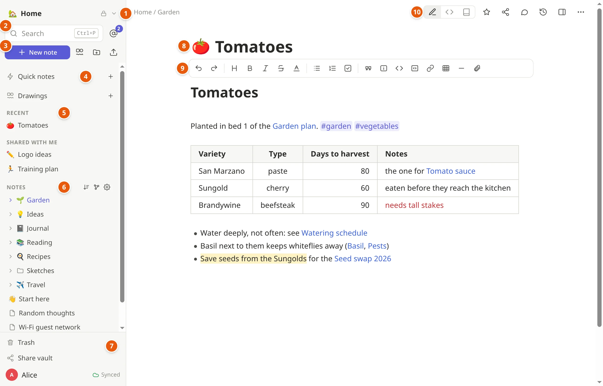
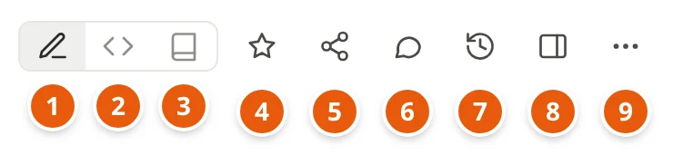
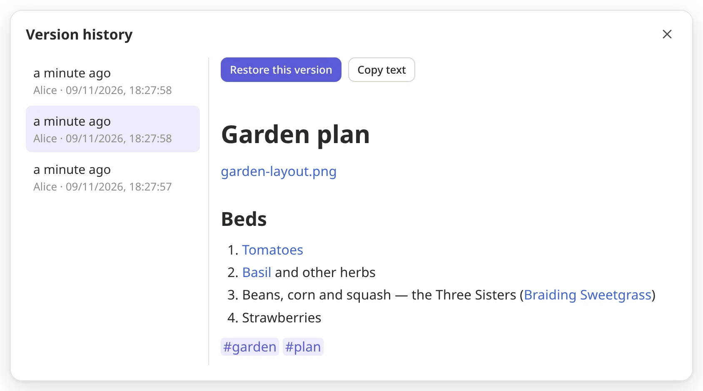
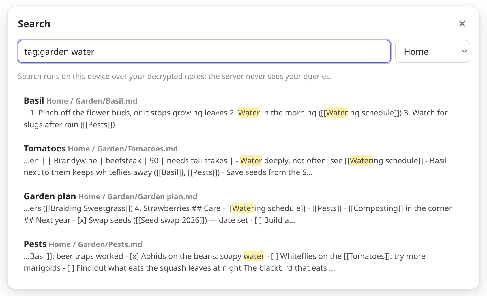
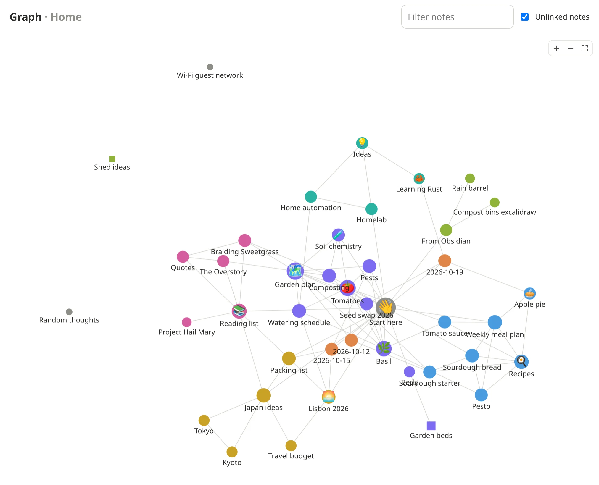
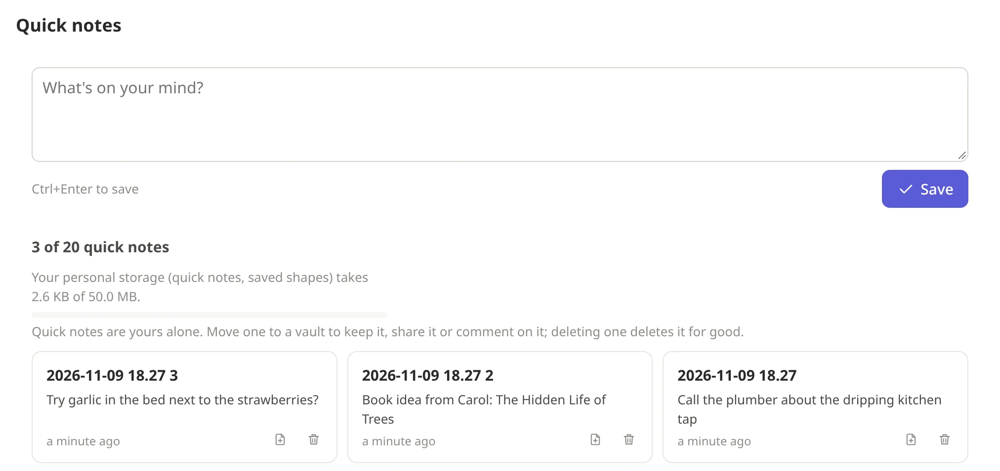
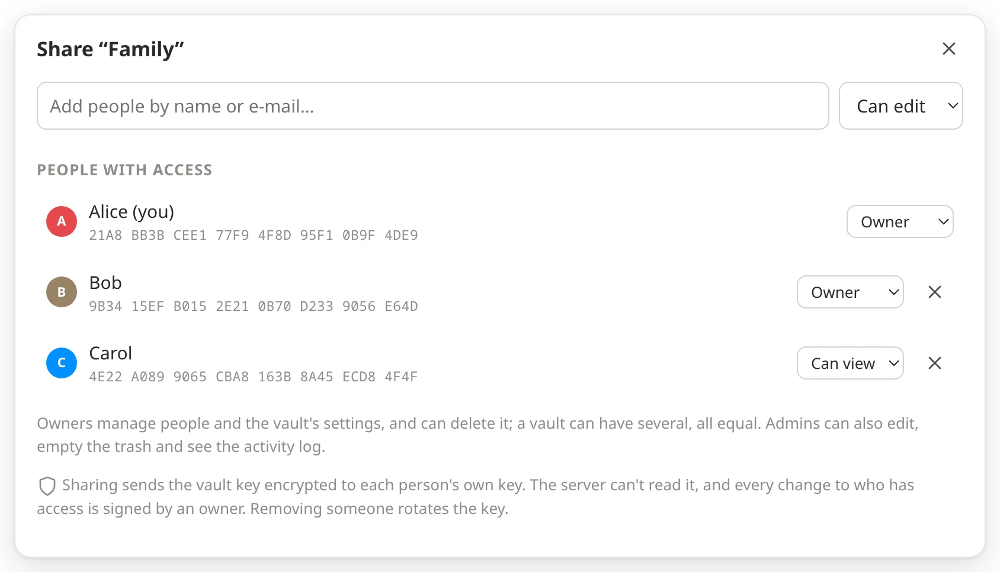
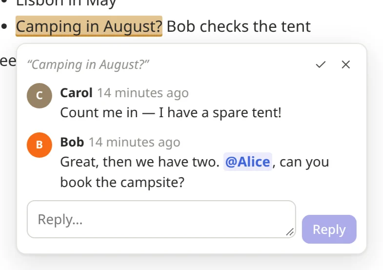

# Getting started

notekpr keeps your notes, drawings and files, in your browser and on any
device you sign in on. Everything is encrypted on your device before it
goes anywhere: the server keeps it, but can't read it, and neither can
whoever runs the server.

This guide walks through the app as you'll use it day to day. Two more
pages go deeper: [Writing notes](writing.md) (headings, lists, links,
pictures, tables, math, diagrams) and [Drawings](drawings.md) (the
whiteboard). [Features](features.md) lists everything, with every
shortcut.

On a Mac, press `⌘` where this guide says `Ctrl`.

## Your first sign-in

1. Sign in the way your server offers: its own sign-in page, or your
   organization's account.
2. notekpr makes your encryption keys on this device. Your notes are
   locked with them before anything is uploaded.
3. **Save your recovery key.** It's shown once: copy it into a password
   manager, or print it and keep it somewhere safe. If you ever lose every
   device you're signed in on, it is the only way back to your notes.
   Nobody can reset it for you, not even whoever runs the server.
   (*Settings → Recovery* makes a new one whenever you need it.)
4. You start in your first vault, *My notes*, with a *Welcome* note of
   things to try. Tick them off as you go, and delete it when you're done.

## Around the app

The sidebar, on the left (on a phone, the button at the top left opens
it):

1. **The vault's name** switches between your vaults. *All vaults* shows
   them all as cards.
2. **Search** jumps to a note by its name (`Ctrl+P`). The **@** beside it
   lists where people mentioned you.
3. **New note**, and beside it buttons for a new drawing, a new folder
   and uploading files.
4. **Quick notes** and **Drawings** (more on both below).
5. **Recent**: the notes you opened lately. Above it, **Favorites** once
   you star a note; below it, **Shared with me**: single notes others
   shared with you.
6. **Notes**: the vault's folders and notes. Click one to open it; each
   row's ⋯ menu renames it, gives it an icon, moves it or deletes it.
7. At the bottom: the **Trash**, **Share vault**, and your name, which
   opens *Settings*, *Keyboard shortcuts*, the theme (light, dark or your
   system's) and *Sign out*. Next to your name: whether everything is
   *Synced*.

The note, on the right:

8. **The title** is the note's name (the icon before it is the note's
   own: click it to choose one). Enter (or `↓`) takes you into the text.
9. **The toolbar** formats the text: headings, bold, lists, checklists,
   links, tables, pictures and more. [Writing notes](writing.md#the-toolbar)
   explains each button.
10. **The buttons at the top right**:

1. **Live preview**: the usual way to see a note, formatted as you type.
2. **Markdown source**: the plain text, every mark showing.
3. **Reading view**: just reading (`Ctrl+E` switches).
4. ☆ adds the note to your *Favorites*.
5. **Share** this one note with someone.
6. **Comments** on the note (a number says how many).
7. **Version history**: its earlier versions.
8. **Side panel** (`Ctrl+\`): links to and from the note, its outline and
   tags.
9. **⋯** for the rest: download it as Markdown, copy a link to it, set an
   icon, move it, move it to the trash.

## There is no save button

Everything is saved as you type, and synced to your other devices and to
everyone you share with, usually within a second. If you're offline, your
changes wait in the browser (the sidebar says *Offline*) and go out when
you're back. Two people changing the same note at the same time is fine:
their edits merge.

## Vaults, folders and notes

* **A vault** holds notes, drawings and files that belong together, and is
  shared as a whole: one for yourself, one for the family, one for work.
  Make one from *All vaults* → *New vault*. Its ⚙ *Vault settings*
  rename it, give it an icon, export it and import notes into it; its
  owners and admins also see its activity log there.
* **Folders** sort the notes in a vault. Drag a note or folder onto a
  folder to move it there, or between two others to put it in that place;
  everyone in the vault sees the same order (*Sort A–Z* puts it back in
  alphabetical order).
* **Icons**: any emoji, or a picture of your own, for a note, folder or
  vault: *Set icon…* in its ⋯ menu, or the icon beside a note's title.
* **Moving to another vault**: *Move to vault…* in the ⋯ menu takes a note
  or a whole folder there, with its pictures and files.
* **The trash**: deleted notes, drawings and files wait there until you
  empty it, and you can restore them. Even emptying it can be undone for a while (30 days,
  unless your server says otherwise).
* **Version history**: every note keeps its earlier versions. The clock at
  the top shows them; pick one to see it, then restore it or copy its text.

  

## Finding things

* **`Ctrl+P`**: type part of a note's name and press Enter. If no note has
  that name, Enter makes one.
* **`Ctrl+Shift+F`** searches the text of every note. Narrow it down with
  `tag:garden`, `folder:Recipes`, `title:plan` or `vault:Work`, and put
  `"words in quotes"` to find them together.

  
* **Tags**: write `#` and a word anywhere in a note (`#ideas`,
  `#garden/tomatoes`). In the reading view, click one to see every note
  with it.
* **Links between notes**: write `[[` and a note's name (see [Writing
  notes](writing.md#links)). The side panel (`Ctrl+\`) shows which notes
  link to the one you're on.
* **The graph** (`Ctrl+G`) draws your notes as dots (drawings as
  squares) and their links as lines, colored by folder. Click a dot to
  open that note.

  
* **A vault's home page** shows its recently edited notes and its tags.

## Quick notes

For a thought you don't want to lose and don't want to file yet. `Alt+Q`
(or *Quick notes* in the sidebar) opens a box: type and save. Quick notes
are yours alone, in no vault, the same from every vault and device. Sort
them out later: *Move to vault…* turns one into a note (its first line
becomes the name), or delete it.

## Pictures and files

Drop or paste a picture, video, recording or any file into a note, or use
the paperclip in the toolbar. It's encrypted and uploaded, and shows (or
plays) where you dropped it. It's kept next to the note, in a folder
called `attachments`. Click a file in the sidebar to open its page: it
shows the file, the notes that use it, and lets you rename, move or
download it. More in [Writing notes](writing.md#pictures-video-sound-and-files).

## Working together

* **Share a vault**: *Share vault* at the bottom of the sidebar. Type the
  person's e-mail address — or, for someone you already share with, their
  name — choose what they may do (*Can view*: read only, *Can edit* or
  *Admin*) and press *Invite*. They get an invitation to accept; once they
  do, they're in — at once if you have notekpr open, otherwise the next time
  you do. Until then they're listed under *Invited*, where the × takes the
  invitation back. To make someone an *Owner*, change their role once
  they're in. [Who can do what](roles.md) has the details.

  
* **When someone invites you**, a bar at the top of the page says who, and
  whether it's a vault or a note (its name shows once you're in): *Accept*
  or *Decline*. Declining doesn't tell them.
* **Share one note** with someone outside the vault: the share button at
  the top of the note, then invite them the same way. They see only that
  note, not the rest of the vault.
* **Write at the same time**: you see each other's cursors with their
  names, and who else is on the note.
* **Comments**: select some text and press `Alt+M` (or the comment button
  that appears). The text gets a highlight; click it to read the thread,
  reply, or mark it resolved (✓). Type `@` and a name to mention someone:
  it shows up under their **@**.

  
* **Checking who you share with**: the sharing dialog shows each person's
  key fingerprint. Comparing it with them (in person, or on a call) makes
  sure the key really is theirs. If someone's key changes, notekpr warns
  you.

## Your other devices

* **Signing in on another device**: sign in there, then approve it from a
  device that's already signed in: a bar at the top of the page asks, with
  a code that must match the one on the new device. No other device at
  hand? Use your recovery key instead.
* **Without the server**: *Settings → Devices → Use without the server*
  lets this browser open and edit your notes even when the server can't be
  reached. Changes sync when it's back.
* **Where you're signed in**: *Settings → Sessions* lists it, and signs a
  device out from afar.
* **On your computer, in your own editor**: the `notekpr` app for your
  computer keeps your notes in a folder of plain Markdown files, for
  Obsidian, VS Code or any editor ([how](own-editor.md)).

## On your phone

notekpr works in your phone's browser, and you can add it to the home
screen: it then opens from its own icon, in a window of its own without
the browser's bars, like any other app.

The sign-in screen offers it: tap **Add to home screen**, and sign in from
the new icon afterwards. On Android that opens the browser's own dialog:
tap **Install** and it's done. On an iPhone or iPad no web page can add
itself, so notekpr shows the steps below. **Not now** puts the offer away
in that browser. Already signed in, or put it away? The steps:

**iPhone and iPad**

1. Open your notekpr address in Safari. Other browsers have the same under
   *Share*.
2. Tap **Share**. In Safari it may be under **⋯** first.
3. Scroll down the list and tap **Add to Home Screen**. Not there? *Edit
   Actions* at the end of the list adds it.
4. Keep **Open as Web App** on, and tap **Add**.
5. Open notekpr from its new icon and sign in. On an iPhone the app keeps
   its own copy of your notes, apart from the browser's, so notekpr counts
   it as a new device: approve it from another device, or with your
   recovery key ([above](#your-other-devices)).

**Android**

1. Open your notekpr address in Chrome.
2. Tap **⋮**, then **Add to Home screen**, then **Install**. (Some versions
   say **Install app** in the menu.)
3. Open notekpr from its new icon.

Other browsers have it in their menu too: in Vivaldi, *Add Page To* →
*Home screen* → *Install*.

To have it start even with no connection at all, turn on *Settings →
Devices → Use without the server* in the app.

## Bringing notes in, taking them out

* **Import**: a vault's *Import notes* takes a folder or `.zip` of
  Markdown files (an Obsidian vault, say) with its pictures, or a Notion
  export.
* **Export**: *Vault settings* → *Export as Markdown (.zip)* downloads a
  vault as plain files any notes app opens. *Settings → Account → Data*
  exports several vaults and your quick notes at once, to move to another
  server.
* **A single note**: ⋯ → *Download as Markdown*.

## Settings

* **Account**: your key fingerprint, how much room your quick notes take,
  exporting and importing everything (*Data*), deleting your account.
* **Devices**: the devices that can open your notes, and this browser's
  offline use.
* **Sessions**: where you're signed in.
* **Recovery**: a new recovery key.
* **AI agents**: give an AI assistant access to only the vaults you choose
  ([agents](agents.md)).
* **Editor**: the theme, line numbers beside the text, Vim keys, how wide
  notes are, and notifications when someone mentions you.

`Ctrl+/` (or `?` outside the editor) lists every keyboard shortcut.
