# Writing notes

Notes are written in Markdown: plain text with a few marks for formatting,
like `**bold**` or `# Heading`, that every notes app and text editor can
read. You don't need to learn it first. The toolbar adds the marks for you,
and the editor shows the formatting as you type: once the cursor leaves a
line, its marks hide and you see the result.

On a Mac, press `⌘` where this page says `Ctrl`. New to notekpr? Start
with [Getting started](getting-started.md).

## Three ways to see a note

The three buttons at the top right of a note:

* **Live preview**, the usual one: formatted as you type. The marks show
  on the line you're editing, so you can change them.
* **Markdown source**: the plain text, every mark showing.
* **Reading view** (`Ctrl+E` switches): just reading. Links open with a
  click, and checklists can still be ticked.

In live preview, a link opens with a click when the cursor isn't on its
line, or with `Ctrl`+click while you're editing it.

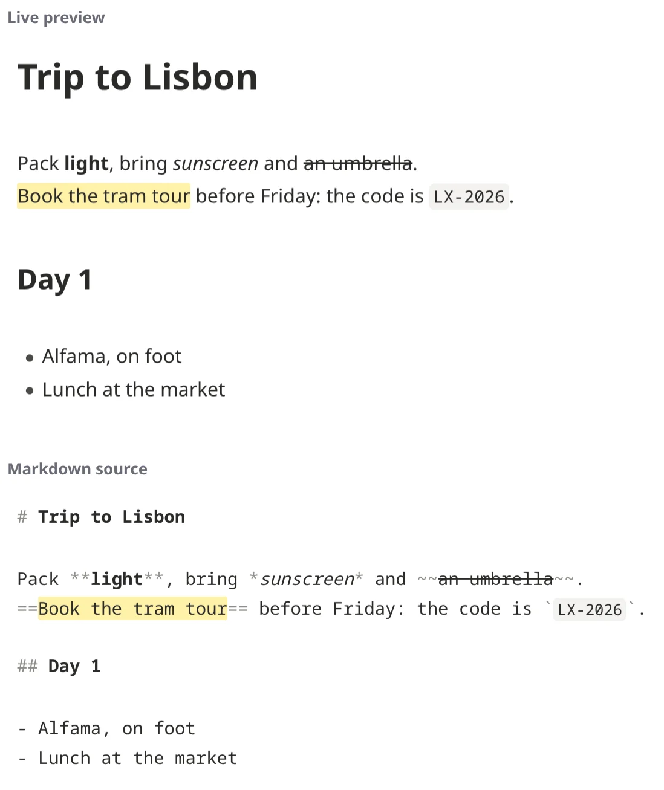

## The toolbar

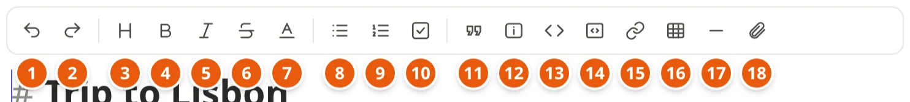

* **1–2**: undo, redo
* **3**: headings (a menu: *Heading 1–3*, *Normal text*)
* **4–6**: **bold**, *italic*, ~~strikethrough~~
* **7**: text and background colors
* **8–10**: bulleted list, numbered list, checklist
* **11–12**: quote, callout (a menu of their types)
* **13–14**: code, code block
* **15–17**: link, table, divider
* **18**: attach a picture or file

Hover over a button to see its shortcut.

## Quick reference

| You type | You get | Shortcut |
|---|---|---|
| `# Heading` … `###### Heading` | Headings, from biggest to smallest | `Ctrl+Alt+1` … `6` |
| `**bold**` | **bold** | `Ctrl+B` |
| `*italic*` or `_italic_` | *italic* | `Ctrl+I` |
| `~~struck~~` | ~~struck~~ | `Ctrl+Shift+X` |
| `==highlighted==` | highlighted (a yellow marker) | `Ctrl+Shift+H` |
| `` `code` `` | `code` | ``Ctrl+` `` |
| `- item` | A bulleted list | `Ctrl+Shift+8` |
| `1. item` | A numbered list | `Ctrl+Shift+7` |
| `- [ ] task` | A checklist item to tick | `Ctrl+Shift+9` |
| `> quoted` | A quote | `Ctrl+Shift+.` |
| `> [!tip]` | A colored callout box | |
| `---` | A divider line | |
| `[text](https://example.org)` | A link to a web page | `Ctrl+K` |
| `[[Another note]]` | A link to a note | `Ctrl+K` |
| `![[photo.jpg]]` | A picture (or video, sound, file) shown in the note | |
| `#tag` | A tag | |
| `@today` | Today's date | |
| `$x^2$` | Math: x² | |
| ```` ```mermaid ```` | A diagram drawn from text | |

To show a mark as itself, put a backslash before it: `\*` shows a `*`,
`\#` a `#`.

## Headings

A `#` and a space at the start of a line make it a heading: `#` is the
biggest, `######` the smallest. Use them to divide a note into parts: they
make the note's outline (in the side panel, `Ctrl+\`), and a link can go
straight to one (`[[Trip plan#Day 2]]`).

The note's name is its title at the top, so the text doesn't need to
start with a heading.

## Bold, italic and more

Select some text and press a toolbar button or its shortcut, or type the
marks around it: `**bold**`, `*italic*`, `~~strikethrough~~`,
`==highlight==`, `` `code` ``. Pressing the same button again takes the
formatting off.

**Colors**: select text and pick a text or background color from the
toolbar's color button. The colors read well in the light and the dark
theme, and other Markdown editors (Obsidian, Typora, VS Code) show them
too.

## Lists and checklists

* Start a line with `- ` (or `* `) for a bulleted list, `1. ` for a
  numbered one.
* Enter starts the next item; Enter on an empty item ends the list.
* `Tab` indents an item under the one above, `Shift+Tab` moves it back
  out. Each level gets its own bullet: a dot, a ring, then a square.
* `- [ ] ` makes a checklist item. Tick it with a click, or `Ctrl+Enter`
  on its line; it becomes `- [x]`.

This:

```
- Groceries
  - Tomatoes
    - Cherry ones, if they have them
  - Bread

1. Preheat the oven
2. Knead the dough

- [x] Book the flights
- [ ] Pack the bags
```

shows as:

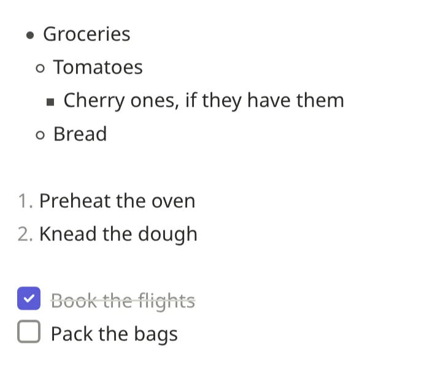

## Links

**To a web page**: paste the address; it becomes a link by itself. To show
other words instead, write `[the words](https://example.org)`, or select
the words and press `Ctrl+K`.

**To another note**: `[[` and the note's name, then `]]`:

* `[[Trip plan]]` links to the note *Trip plan*;
* `[[Trip plan|our plan]]` shows "our plan" instead;
* `[[Trip plan#Day 2]]` goes to its heading *Day 2*;
* `[[Travel/Trip plan]]` says which folder, if two notes have the same
  name.

A link to a note that doesn't exist yet looks different, and clicking it
makes that note. That's a good way to write: link the things you mean to
write about, and fill them in later. Renaming a note updates every link to
it.

`Ctrl+K` with nothing selected starts a note link (`[[ ]]`).

This:

```
The timetable is on https://example.org/trams, the tours on
[the tram company's site](https://example.org).

Plans are in [[Trip plan]], the day trip in [[Trip plan#Day 2|our day trip]].

Still to write: [[Restaurants to try]].
```

shows as (the last link, to a note not written yet, underlined with dots):

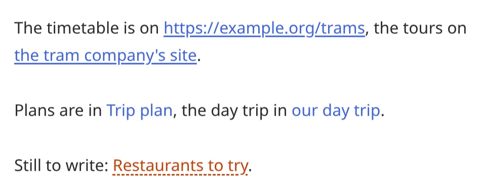

## Pictures, video, sound and files

Drop a file into a note, paste it, or use the paperclip in the toolbar.
It's encrypted and uploaded, then:

* pictures show where you dropped them;
* videos and recordings play there;
* other files (a PDF, a spreadsheet) show as a link to the file.

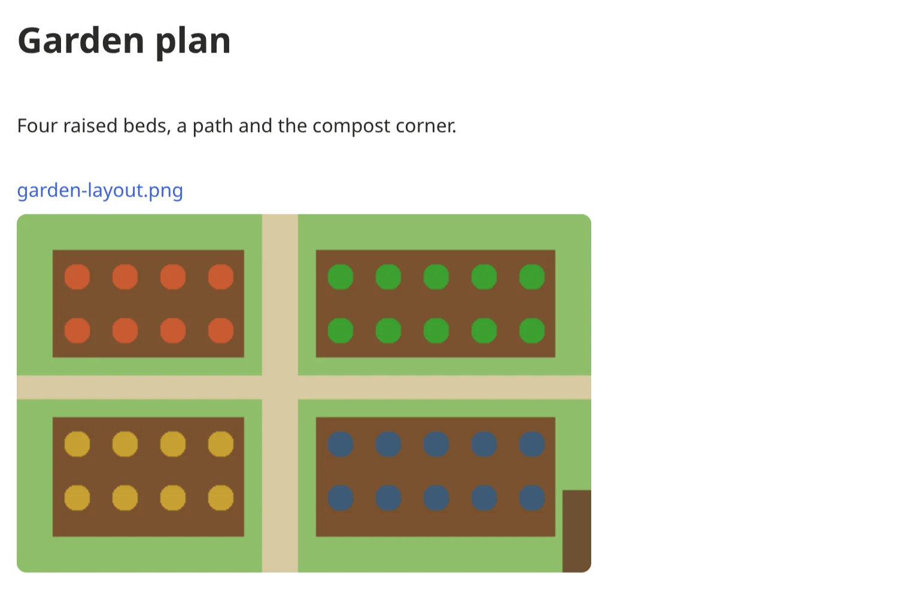

In the text, a file is `![[photo.jpg]]`: the `!` means "show it here";
without it, `[[photo.jpg]]` is just a link. Files go into a folder called
`attachments` next to the note, and keep their names unique in the vault,
so the same notes open in Obsidian too.

To show a picture at a size of your own, write it as HTML:
``.

Pictures from other websites (``) aren't loaded, so no
website can tell when you read your note. Save the picture and drop it in
instead.

## Tables

The toolbar's table button starts one. Then:

* `Tab` moves to the next cell, `Shift+Tab` back;
* Enter adds a row; Enter on an empty row ends the table.

Columns line up by themselves. In the text a table looks like this:

```
| Day | Where   |
| --- | ------- |
| 1   | Lisbon  |
| 2   | Sintra  |
```

and shows like this:

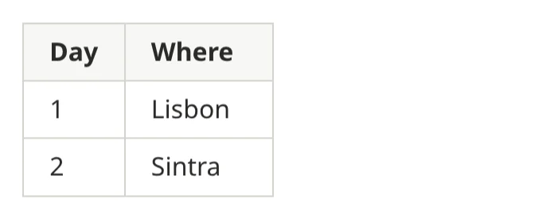

A table wider than the page scrolls sideways.

## Quotes and callouts

A line starting with `> ` is a quote. A **callout** is a colored box with
an icon, for tips, warnings and the like. The toolbar's callout button
makes one, or type it:

```
> [!tip] Water in the morning
> The soil holds it better before the heat.

> [!warning] Frost on Thursday
> Cover the seedlings.

> [!faq]- Can basil go outside?
> Only once the nights stay above 10 °C.
```

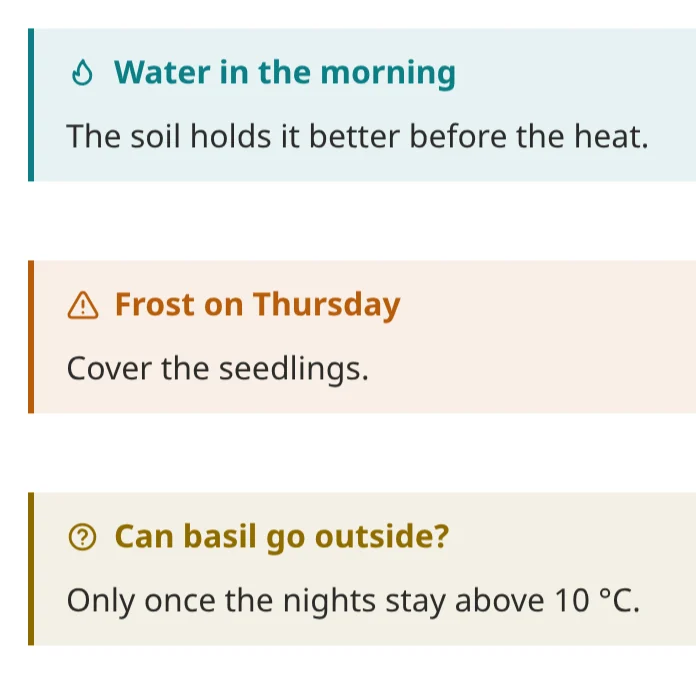

The word in brackets is the type: `note`, `info`, `tip`, `success`,
`question`, `warning`, `danger`, `bug`, `example`, `quote` and more, each
with its color and icon. After it comes an optional title. `[!faq]-` makes
one that folds closed (click its title to open it), `[!faq]+` one that
starts open. They're written the same way as in Obsidian and on GitHub.

## Code

`` `code` `` marks a word or two as code. For several lines, use a code
block: the toolbar button, ``Ctrl+Shift+` ``, or three backticks and the
language:

````
```python
print("hello")
```
````

The code is colored for its language (some 35 of them), with line numbers
and a copy button. After the language you can add a file name
(`title=deploy.sh`), highlight lines (`hl=2,4-6`), or turn off the line
numbers (`ln=false`) and wrapping (`wrap=false`). This:

````
```python title=hello.py hl=2
name = "notekpr"
print(f"hello, {name}")
```
````

shows as:

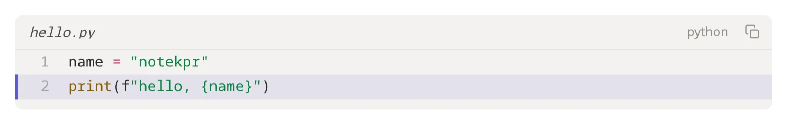

## Math

Formulas are written in LaTeX, the language scientists and textbooks use
for math. Put a formula between dollar signs inside a sentence:
`$E = mc^2$`. For a formula on its own, centered, put it between double
dollar signs, on its own lines:

```
Einstein's $E = mc^2$, in a sentence. On its own:

$$
\frac{-b \pm \sqrt{b^2 - 4ac}}{2a}
$$
```

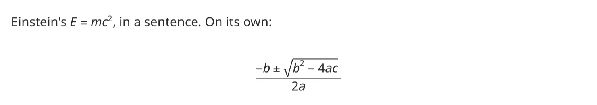

A few things to start with:

| You type | You get |
|---|---|
| `x^2`, `x_1` | a power, an index |
| `\frac{a}{b}` | a fraction |
| `\sqrt{x}` | a square root |
| `\alpha`, `\beta`, `\pi` | Greek letters |
| `\sum_{i=1}^{n} i` | a sum |
| `\int_0^1 x\,dx` | an integral |
| `\le`, `\ne`, `\approx`, `\times` | ≤, ≠, ≈, × |

The formula shows typeset once the cursor leaves it. Click it to change
it: its LaTeX shows, and a formula on its own lines keeps showing under
its LaTeX while you type. One that can't be typeset shows its LaTeX in
red; hover over it to see why.

A dollar sign before a number stays a dollar sign: `$5 and $10` is about
money. To write one anywhere, type `\$`.

## Chemistry

Inside a formula, `\ce{…}` writes chemistry the easy way:

| You type | You get |
|---|---|
| `$\ce{H2O}$` | water, the 2 set low |
| `$\ce{2H2 + O2 -> 2H2O}$` | a reaction with its arrow |
| `$\ce{SO4^2-}$` | an ion |
| `$\ce{^{14}C}$` | an isotope |
| `$\ce{A <=> B}$` | an equilibrium |
| `$\pu{123 kJ/mol}$` | a value with its units |

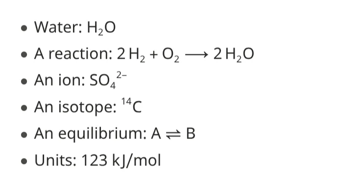

It's the notation (mhchem's) that Obsidian and Joplin use too.

## Diagrams

A diagram is a picture made from text. You describe it — these boxes,
connected like this — and notekpr draws it, arranging the boxes for you.
It uses **Mermaid**, a small language for diagrams that Obsidian and
GitHub understand too, so the same notes show the same diagrams there.

Write it in a code block whose language is `mermaid`:

````
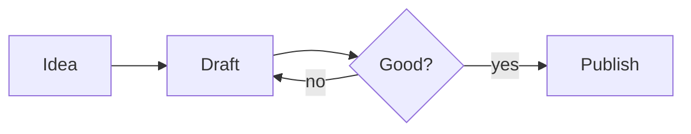
````

This draws a flowchart from left to right (`LR`; `TD` goes top down):

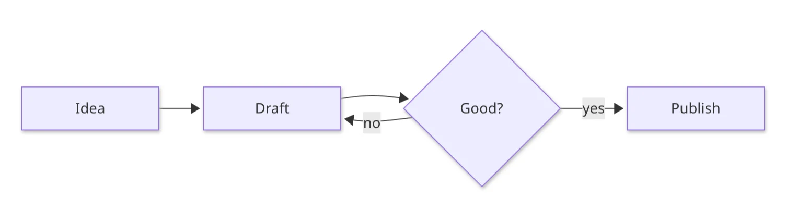

* each name is a box; `Review{Good?}` gives the box *Review* the text
  "Good?" and a diamond shape (`[text]` is a rectangle, `(text)` rounded,
  `((text))` a circle);
* `-->` is an arrow, `-->|yes|` an arrow with a label.

Mermaid draws many other kinds. A sequence diagram, who sends what to
whom:

````
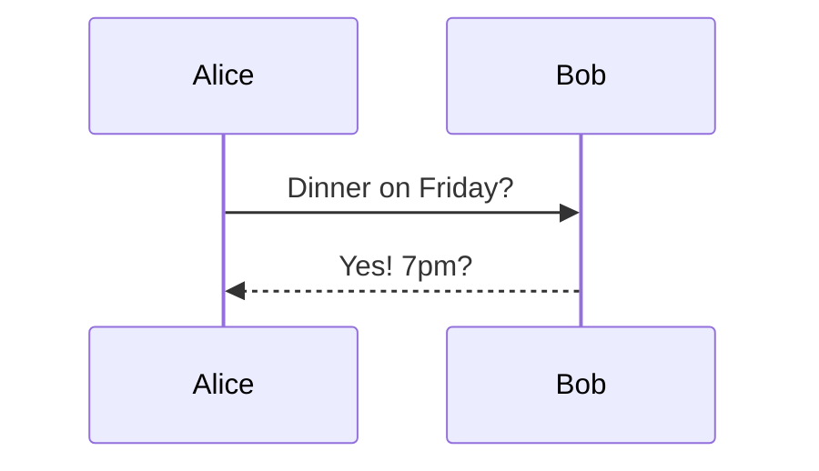
````

A pie chart:

````
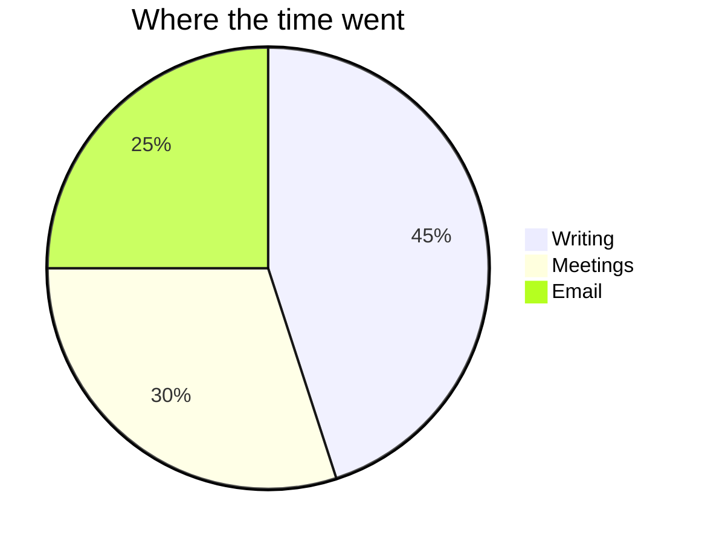
````

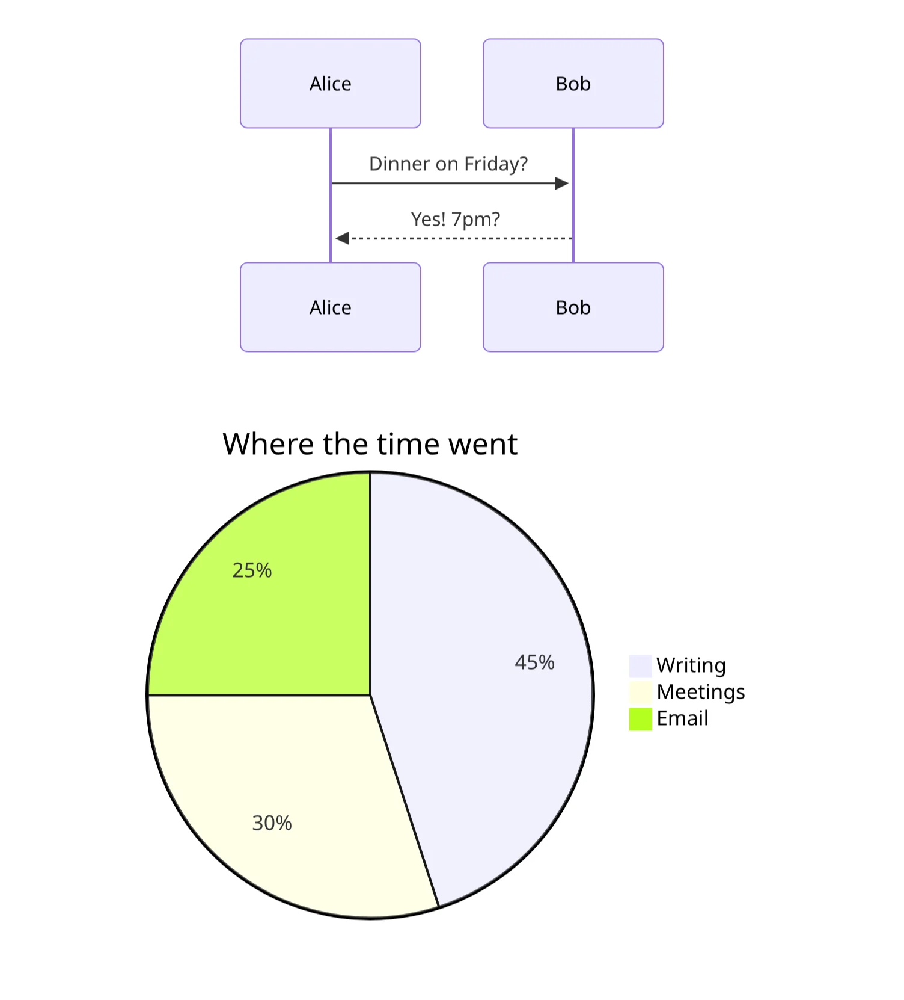

And Gantt charts (plans on a timeline), mind maps, timelines, class,
state and entity–relationship diagrams, and more:
[Mermaid's documentation](https://mermaid.js.org/intro/) shows every kind,
with examples to copy.

**Editing one**: click the diagram. Its text shows, and the diagram stays
under it, redrawn as you type. Click elsewhere and only the diagram shows
again. It follows the light or dark theme. If the text has a mistake, a
red line says what's wrong instead of the diagram.

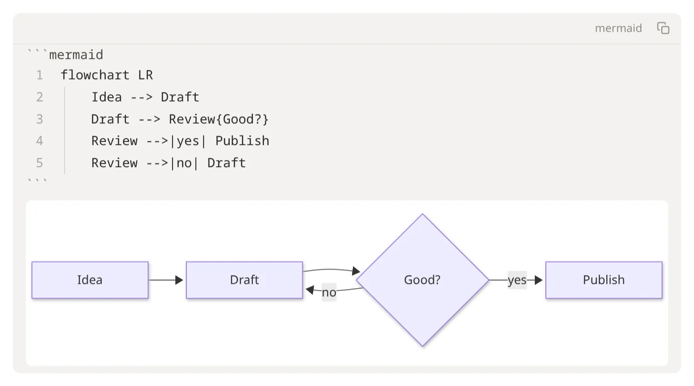

**Links in a diagram**:

* `click Idea href "https://example.org"` makes the box *Idea* open that
  web page, in a new tab;
* `class Draft internal-link` makes the box *Draft* open the note named
  like the box's text, here *Draft*, just like `[[Draft]]` (and makes it
  if there's none yet). That's how Obsidian links diagram boxes to notes,
  so it works in both. Several at once: `class Idea,Draft internal-link`.
  Such links don't show up as backlinks, as in Obsidian.

The first time you open a note with a diagram, the app loads what draws
them (a moment's wait, once).

## Diagram or drawing?

notekpr has both, and they're for different things.

| | A diagram | A [drawing](drawings.md) |
|---|---|---|
| You make it by | typing what's connected to what | drawing it, with a mouse, pen or finger |
| The layout | done for you: add a box and the rest move aside | yours: everything stays where you put it |
| It lives | inside a note, as text | in a file of its own next to your notes, shown in a note with `![[Name.drawing]]` |
| It looks | neat and uniform | hand-drawn (or neat), with your colors and fonts |
| Best for | flowcharts, steps, plans on a timeline, who-talks-to-whom, anything that changes often | sketches, whiteboards, floor plans, free mind maps, notes on a picture |
| Also opens in | Obsidian, GitHub, anything that reads Mermaid | Excalidraw, Obsidian's Excalidraw plugin |

Rule of thumb: if you'd rather say it than draw it, and want it to tidy
itself up when it changes, make a diagram. If where things sit matters, or
you want to sketch freely, make a drawing.

## Dates

Type `@today`, `@tomorrow` or `@yesterday` (or pick a day from the menu
that `@` opens), and the note gets that day's date, such as `@2026-10-23`.
It shows as *Today*, *Tomorrow* or *Yesterday* while it is one, and as
the date after that:

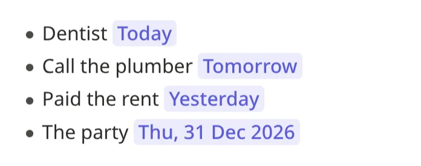

## Tags

`#` and a word, anywhere in a note: `#recipe`, `#to-read`,
`#garden/tomatoes`. Letters, numbers, `-`, `_` and `/`, no spaces. Find
them with search (`tag:recipe`), in the side panel and on the vault's
home page.

## HTML, for what Markdown can't do

A few HTML tags work in notes, for things Markdown has no marks for:

* `<details><summary>Spoiler</summary>The butler did it.</details>`: a
  section that folds open;
* `<kbd>Ctrl</kbd>` for keys, `H<sub>2</sub>O` and `x<sup>2</sup>`;
* `<div align="center">…</div>` to center something;
* `` for a picture's size.

Only formatting is kept: no scripts, styles, frames or forms.

## Undo, and earlier versions

`Ctrl+Z` undoes, `Ctrl+Shift+Z` (or `Ctrl+Y`) redoes your own changes,
not those of others writing in the note at the same time. For anything
older, the note's *Version history* (the clock at the top) shows its
earlier versions and restores one.

## Keyboard shortcuts

`Ctrl+/` shows them all. The ones for writing:

| Keys | Does |
|---|---|
| `Ctrl+B`, `Ctrl+I` | Bold, italic |
| `Ctrl+Shift+X`, `Ctrl+Shift+H` | Strikethrough, highlight |
| ``Ctrl+` ``, ``Ctrl+Shift+` `` | Code, code block |
| `Ctrl+K` | Link |
| `Ctrl+Alt+1` … `6`, `Ctrl+Alt+0` | Heading level, normal text |
| `Ctrl+Shift+8`, `7`, `9`, `.` | Bulleted, numbered, checklist, quote |
| `Ctrl+Enter` | Tick or untick a checklist item |
| `Tab`, `Shift+Tab` | Indent or outdent a list item; next or previous table cell |
| `Ctrl+Z`, `Ctrl+Shift+Z` | Undo, redo |
| `Alt+M` | Comment on the selected text |
| `Ctrl+E` | Reading view |

Settings → Editor turns on Vim keys, for those who know them.
